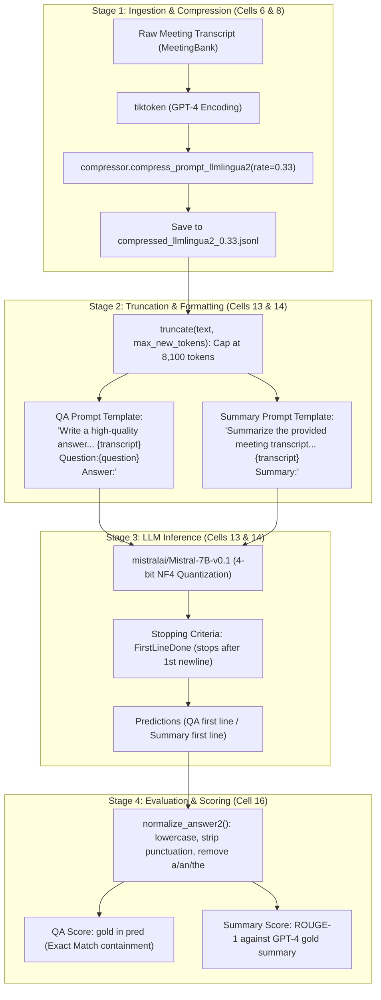

# Where is the "Pipeline" in Your Friend's Notebook?

**User Question:** *"My friend talked about describing the pipeline in the notebook. I don't see where that is."*

---

## 1. The Short Answer: There is No Dedicated "Pipeline" Section

If you are looking for a section titled *"Pipeline Description"* or a visual diagram in the notebook, **it does not exist**. 

The word **"pipeline"** only appears twice in the entire notebook, both times in the very last cell (**Cell 17 — Verdict**):
> 1. *"The **pipeline** itself looks sound: compression ratio and original-prompt scores match the paper."*  
> 2. *"There is no strong result to inherit, so any improvement has to come from our side: the data (input length, task type), the **pipeline** (truncation, prompt format, quantization) or the compression settings (rate, model)."*

---

## 2. What Your Friend Actually Meant by "The Pipeline"

When your friend says *"the pipeline"*, they are referring to the **series of code functions across Cells 8, 13, 14, and 16** that process a meeting transcript from raw text to final score.

Here is the exact 4-stage pipeline implemented in their code:



---

## 3. Cell-by-Cell Code Breakdown of the Pipeline

### Step 1: Compression Pipeline (Cell 8)
- Takes a raw transcript from `microsoft/MeetingBank-QA-Summary`.
- Calls `compressor.compress_prompt_llmlingua2(...)` with:
  - `rate = 0.33` (Target 3x compression).
  - `force_tokens = ["\n", "?", "!", "."]` (Preserves line breaks and sentence ends).
  - `drop_consecutive = True` (Cleans duplicate punctuation).
- Saves the compressed text to Google Drive so it doesn't need to re-run if disconnected.

### Step 2: Context Truncation (Cell 13)
```python
def truncate(text, max_new_tokens):
    ids = enc.encode(text)
    limit = N_MAX_TOKEN - max_new_tokens  # 8100 - max_new_tokens
    return enc.decode(ids[:limit]) if len(ids) > limit else text
```
- Even with compression, some meeting transcripts are over 15,000 tokens long.
- Mistral-7B has an 8,192-token context window. This function cuts off any text exceeding 8,100 tokens.

### Step 3: Prompt Formatting & Mistral Inference (Cell 13 & 14)
- **QA Prompt:**
  ```text
  Write a high-quality answer for the given question using the provided meeting transcript (which may be compressed).
  {transcript}
  Question:{question}
  Answer:
  ```
- **Stopping Criterion (`FirstLineDone`):**  
  Mistral-7B is an unaligned base model, meaning it will ramble forever unless stopped. The author created a custom `StoppingCriteria` that halts generation as soon as Mistral outputs a newline `\n`.

### Step 4: Normalization & Scoring (Cell 16)
- **QA Metric (`qa_score`):**
  Checks whether the normalized ground-truth answer string is contained in the first line of Mistral's output.
- **Summary Metric:**
  Calculates Hugging Face `evaluate` ROUGE-1 of Mistral's summary against the GPT-4 reference summary.

---

## 4. Why Your Friend Wrote About "The Pipeline" in Cell 17

In the verdict (Cell 17), your friend concluded:
> *"There is no strong result to inherit, so any improvement has to come from our side: the data (input length, task type), **the pipeline (truncation, prompt format, quantization)** or the compression settings (rate, model)."*

Your friend is pointing out that their current pipeline has **three major bottlenecks**:
1. **Truncation:** Cutting text at 8,100 tokens arbitrarily chops off the end of long meetings.
2. **Prompt Format:** Raw base Mistral-7B needs rigid prompt formatting, or it produces erratic answers.
3. **Quantization:** Compressing Mistral down to 4-bit (`nf4`) degrades its reading comprehension.
