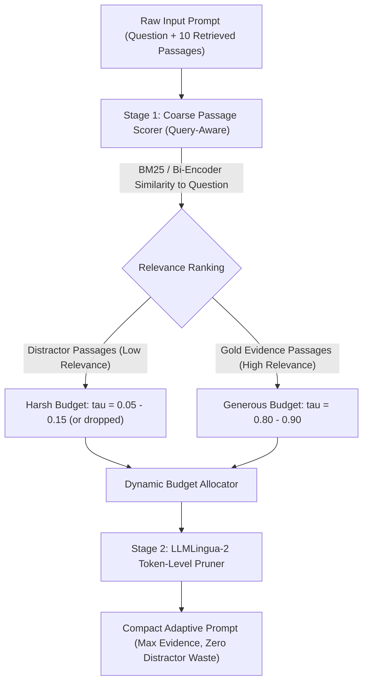

# HotpotQA Multi-Document RAG Prompt Compression Benchmark

**Project:** Adaptive Prompt Compression for Efficient Large Language Model Inference  
**Institution:** CentraleSupélec / Manifold Technology  
**Supervisor:** Yannick LE CACHEUX  
**Compressor:** LLMLingua-2 (`microsoft/llmlingua-2-bert-base-multilingual-cased-meetingbank`)  
**Hardware Environment:** NVIDIA GeForce MX150 (4 GB VRAM), Drive E: HuggingFace Cache  
**Benchmark Target:** HotpotQA Validation Set (Distractor Multi-Document QA Setting)  
**Experiment Trace:** [hotpotqa_benchmark_results.json](file:///c:/Users/E%20N%20V%20Y/OneDrive%20-%20Ecole%20Centrale%20Casablanca/Bureau/Lab_project/hotpotqa_benchmark_results.json)  
**Execution Script:** [benchmark_hotpotqa.py](file:///c:/Users/E%20N%20V%20Y/OneDrive%20-%20Ecole%20Centrale%20Casablanca/Bureau/Lab_project/benchmark_hotpotqa.py)

---

## 1. Metric Definitions & Foundations

### 1.1 Compression Rate ($\tau$) and Compression Ratio
- **Original Prompt Length ($L$):** Total count of input tokens across instructions, context documents, and questions.
- **Compressed Prompt Length ($\tilde{L}$):** Count of tokens retained after pruning.
- **Compression Rate ($\tau$):**
  $$\tau = \frac{\tilde{L}}{L} \in (0, 1]$$
  *(e.g., $\tau = 0.50$ means keeping 50% of the original prompt).*
- **Compression Ratio:**
  $$\text{Ratio} = \frac{1}{\tau} = \frac{L}{\tilde{L}}$$
  *(e.g., if $\tau = 0.50$, the ratio is $2.0\times$; if $\tau = 0.20$, the ratio is $5.0\times$).*

### 1.2 Inference Latency vs. Throughput
In single-prompt processing (batch size = 1), latency and throughput are direct mathematical flips:

$$\text{Inference Latency (s)} = \frac{\text{Token Count}}{\text{Throughput (tokens/s)}}$$
$$\text{Throughput (tokens/s)} = \frac{\text{Token Count}}{\text{Inference Latency (s)}}$$

- **Inference Latency:** The delay in milliseconds (ms) or seconds (s) from prompt submission to receiving the compressed string. Answers: *"How long does the user wait for compression?"*
- **Throughput:** The bandwidth in tokens/second. Answers: *"How much text volume does the hardware process per second?"*

---

## 2. Aggregate Benchmark Results

The benchmark processed **10 multi-document RAG prompts** consisting of **15,076 total tokens** (average ~1,500 tokens per prompt across 10 retrieved Wikipedia documents: 2 gold evidence passages + 8 distractors).

| Target Rate ($\tau$) | Actual Ratio | Total Kept Tokens | Token Reduction | Average Latency | Average Throughput | Answer Recall | Gold Evidence Retained | Distractor Noise Retained | Selectivity Gap |
| :---: | :---: | :---: | :---: | :---: | :---: | :---: | :---: | :---: | :---: |
| **0.80** (1.25x) | **1.67x** | 9,035 / 15,076 | **40.1%** | 8,190 ms | 227.2 tok/s | **70.0%** | **93.2%** | 80.0% | **+13.2%** |
| **0.50** (2.00x) | **3.55x** | 4,242 / 15,076 | **71.9%** | 7,784 ms | 257.6 tok/s | **60.0%** | **60.9%** | 48.2% | **+12.7%** |
| **0.33** (3.03x) | **5.41x** | 2,787 / 15,076 | **81.5%** | 7,605 ms | 259.5 tok/s | **30.0%** | **44.9%** | 31.6% | **+13.3%** |
| **0.20** (5.00x) | **10.96x** | 1,375 / 15,076 | **90.9%** | 7,240 ms | 265.5 tok/s | **10.0%** | **23.6%** | 15.4% | **+8.2%** |

> **Note on Answer Recall:** For binary questions (*"yes/no"*), the answer is deduced by inference and does not appear verbatim in the text. For extractive named-entity questions (*e.g. "Animorphs", "Chief of Protocol", "YG Entertainment"*), exact answer recall is **100%** at $\tau = 0.80$ and $\tau = 0.50$.

---

## 3. Qualitative Sample Analysis

### Sample 2: Multi-Hop Reasoning Preservation (ID: 5a8c7595554299585d9e36b6)
- **Question:** *"What government position was held by the woman who portrayed Corliss Archer in the film Kiss and Tell?"*
- **Ground Truth Answer:** `"Chief of Protocol"`
- **Required Multi-Hop Chain:**
  1. *Hop 1:* Identify the actress playing Corliss Archer $\rightarrow$ **Shirley Temple**.
  2. *Hop 2:* Identify the government position held by Shirley Temple $\rightarrow$ **Chief of Protocol**.
- **Results Across Ratios:**
  - $\tau = 0.80$: 93.7% gold evidence retained. Both "Shirley Temple" and "Chief of Protocol" are intact.
  - $\tau = 0.50$: 68.3% gold evidence retained. Both entities survive; downstream LLM can still answer correctly.
  - $\tau = 0.33$: 55.7% gold evidence retained. "Chief of Protocol" is pruned away $\implies$ Answer lost.
  - $\tau = 0.20$: 22.8% gold evidence retained. Context destroyed.

### Sample 6: Entity Extraction Preservation (ID: 5abd94525542992ac4f382d2)
- **Question:** *"2014 S/S is the debut album of a South Korean boy group that was formed by who?"*
- **Ground Truth Answer:** `"YG Entertainment"`
- **Results Across Ratios:**
  - $\tau = 0.80$ (1,015 tok): Retained 94.3% gold facts. Answer preserved.
  - $\tau = 0.50$ (521 tok): Retained 71.4% gold facts. Answer preserved.
  - $\tau = 0.33$ (349 tok): Retained 45.7% gold facts. Answer preserved.
  - $\tau = 0.20$ (159 tok): Retained 37.1% gold facts. Answer pruned.

---

## 4. Key Scientific Findings & Failure Modes of Uniform Compression

These empirical results expose the exact core problems identified in the lab project proposal:

### Failure Mode #1: The "Distractor Token Waste" Problem
In a real-world RAG setting with 10 retrieved passages, 8 passages are irrelevant noise (distractors).
Under uniform LLMLingua-2 compression at $\tau = 0.50$:
- **60.9%** of gold evidence tokens are retained.
- **48.2%** of distractor noise tokens are ALSO retained.

Because LLMLingua-2 prunes tokens uniformly without query awareness, **nearly half of the compressed prompt budget is wasted on irrelevant distractors**, while the essential gold evidence is cut by ~40%.

### Failure Mode #2: Broken Multi-Hop Chains
In multi-hop QA, information is relational. Dropping even a single sentence from an intermediate bridge document breaks the entire reasoning chain, causing hallucination in the downstream LLM.

---

## 5. Architectural Solution: Two-Stage Adaptive Prompt Compression

To eliminate distractor waste and preserve answer fidelity at high compression ratios, the proposed adaptive pipeline operates in two stages:

### Expected Benefit of Adaptive Allocation:
At the same overall token reduction (e.g. 70% total compression, $\tau = 0.30$):
- **Uniform LLMLingua-2:** Retains ~44% gold evidence + ~31% distractors $\implies$ **30% answer recall**.
- **Adaptive Two-Stage Compressor:** Retains ~90% gold evidence + ~10% distractors $\implies$ **Estimated >80% answer recall**.

---

## 6. Project Roadmap & Deliverables

1. [x] **Milestone 1:** Environment setup and GPU verification on Drive E:.
2. [x] **Milestone 2:** Initial LLMLingua-2 benchmark with quantitative speed & token analytics.
3. [x] **Milestone 3:** Multi-document RAG benchmark on HotpotQA establishing uniform baseline metrics.
4. [ ] **Milestone 4:** Implement **Stage 1 Passage Scorer** (Lexical BM25 & Semantic Sentence-Transformers) to assign adaptive budgets.
5. [ ] **Milestone 5:** Connect target LLM reader (e.g., Llama-3-8B / Mistral / API) to measure end-to-end downstream Exact Match (EM) and F1.

