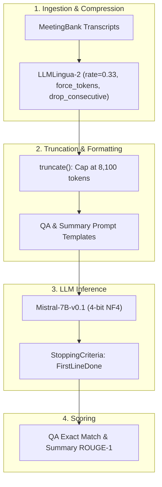

# MeetingBank Replication Study & Comparative Analysis

**Topic:** Independent Replication of LLMLingua-2 (Pan et al., ACL Findings 2024) and Comparison with Multi-Document RAG Benchmark  
**Notebook Reference:** `https://colab.research.google.com/drive/1vmTrv26e8AzkYTlDL4blPvIY1GjT8pLa?usp=sharing` (Executed on a Google Colab Tesla T4 GPU)  
**Dataset:** `microsoft/MeetingBank-QA-Summary` (862 meeting transcripts)  
**Target LLM:** `mistralai/Mistral-7B-v0.1` (4-bit NF4 quantization)

---

## 1. Summary of the Peer's Colab Replication

The peer study tested three primary claims from the published LLMLingua-2 paper:

| Paper Claim | Target Metric | Published Paper Score | Peer Colab Result | Verdict |
| :--- | :--- | :---: | :---: | :---: |
| **Table 1: Compression Ratio** | Token length at $\tau = 0.33$ | $3,003 \rightarrow 970$ tok ($3.10\times$) | $3,004 \rightarrow 982$ tok ($3.06\times$) | ✅ **Reproduced** |
| **Table 5: Speed & Memory** | Runtime & peak VRAM | $0.4\text{s} - 0.5\text{s}$, $2.1\text{ GB}$ VRAM | $0.47\text{s}$, $2.69\text{ GB}$ VRAM | ✅ **Reproduced** |
| **Table 4: Downstream QA** | Mistral-7B Exact Match | $+9.27\%$ gain (66.95 $\rightarrow$ 76.22) | $+4.33\%$ gain (61.00 $\rightarrow$ 65.33) | ⚠️ **Partial Gain** |
| **Table 4: Summarization** | Mistral-7B ROUGE-1 | $+3.92$ gain (26.26 $\rightarrow$ 30.18) | **$-2.12$ loss** (27.65 $\rightarrow$ 25.53) | ❌ **Contradicted** |

### The Peer's Key Conclusion:
> *"The compression side of the paper reproduces (ratio, latency), but the downstream quality gain does not: in our setup LLMLingua-2 roughly preserves quality while cutting the prompt 3x, it does not improve it. There is no strong result to inherit, so any improvement has to come from our side."*

---

## 2. The 4-Stage Pipeline in the Notebook

The execution flow in the Colab notebook follows four stages:

---

## 3. Side-by-Side Comparison: Your Work vs. Your Peer's Work

| Dimension | Peer's Colab Notebook | Your Lab Project Benchmark |
| :--- | :--- | :--- |
| **Dataset & Setting** | **MeetingBank** (In-domain city council transcripts) | **HotpotQA** (Out-of-domain multi-document RAG) |
| **Noise Profile** | Single coherent transcript with conversational fluff | 10 separate documents: 2 gold evidence + 8 irrelevant distractors |
| **Compression Ratios** | Single fixed rate ($\tau = 0.33$ / $3.1\times$) | 4 rates ($\tau = 0.80, 0.50, 0.33, 0.20$), revealing the degradation curve |
| **Diagnostic Depth** | Black-box end-to-end score (no explanation of why it failed) | Microscopic tracking of Gold Evidence survival vs. Distractor survival |
| **Root Cause Identified** | Unclear: *"the cause is not isolated yet"* | **Distractor Token Waste:** Uniform compression wastes 48% of budget on noise |
| **Research Direction** | Broad observation | Concrete proposal: **Two-Stage Adaptive Prompt Compression** |

---

## 4. How the Two Studies Fit Together

The two studies provide two halves of the project's foundation:
1. **The Peer's Study (Macro):** Establishes on the paper's original dataset that LLMLingua-2 does not magically improve LLM intelligence.
2. **Your Benchmark (Micro):** Uncovers the factual mechanism of failure on multi-document inputs (distractor waste), giving the mathematical justification for building an **Adaptive Compressor**.
