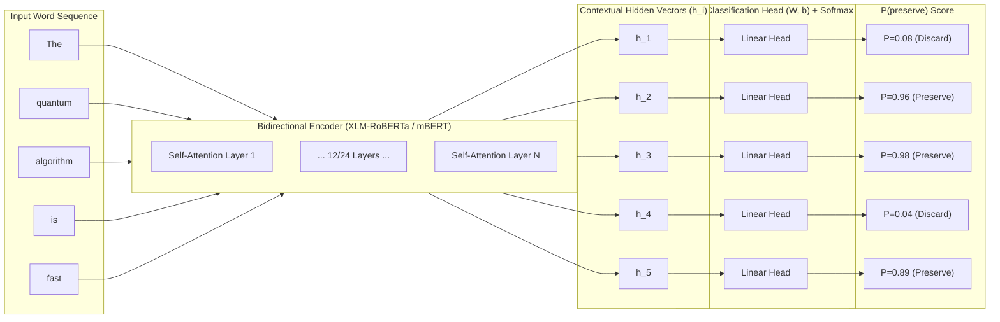
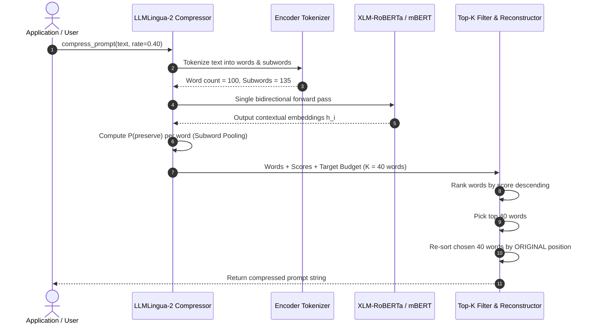

# Building LLMLingua-2 from Scratch: The Complete Beginner's Guide

> **Paper Title:** *LLMLingua-2: Data Distillation for Efficient and Faithful Task-Agnostic Prompt Compression* (Findings of ACL 2024)  
> **Core Concept:** Supervised Token Classification via Bidirectional Transformer Encoders  
> **Target Audience:** Anyone starting from zero who wants to understand and build LLMLingua-2 step-by-step.

---

## 1. The Paradigm Shift: Why Scrap LLMLingua-1?

In LLMLingua-1, we used a causal language model (like LLaMA or GPT-2) and calculated **Perplexity (Surprise)** to decide which words to drop. 

While clever, it had three major flaws:
1. **Perplexity Is the Wrong Metric:** A language model is trained to predict the *next word*. It was never trained to decide *which words are necessary for compression*. Just because a word is predictable does not mean you can safely delete it.
2. **The "Unidirectional Blindspot":** Causal models only look **left-to-right**. But in human language, the importance of a word frequently depends on what words appear **after** it.
3. **Too Heavy & Slow:** Running a 7B model iteratively with KV-cache takes ~16.6 GB of VRAM and ~2.5 seconds per prompt.

### The Breakthrough Idea of LLMLingua-2
Instead of guessing word importance using perplexity, **treat prompt compression as a Binary Token Classification problem**:
- Look at every word in the text.
- Use a **Bidirectional Transformer Encoder** (like XLM-RoBERTa or BERT) that reads both left and right context simultaneously.
- For each word, classify: **$1$ (Preserve)** or **$0$ (Discard)**.

---

## 2. Beginner's Glossary: The Jargon Explained

| Term | Plain English Definition | Real-World Analogy |
| :--- | :--- | :--- |
| **Token Classification** | Giving an individual tag/label to every single token in a text (e.g., Tagging each word as Keep or Delete). | A teacher going through an essay with a yellow highlighter to mark only the essential words. |
| **Transformer Encoder** | A neural network (like BERT or RoBERTa) that reads the entire sentence in all directions at once (**bidirectional**). | Reading an entire sentence as a complete picture, rather than reading word-by-word through a peephole. |
| **Data Distillation** | Using a huge, smart model (GPT-4) to create clean training examples, and using those examples to train a tiny model to do the exact same job. | A master chef teaching an apprentice their best recipes. |
| **Lemmatization** | Reducing different grammatical forms of a word back to its base root dictionary form (lemma). e.g., `"running"`, `"ran"`, `"runs"` all become `"run"`. | Stripping the paint off a table to see the bare wood underneath. |
| **Sliding Window** | A technique where you restrict your search to a small local neighborhood around your current position, rather than scanning the entire document. | Looking for your lost keys only in the living room where you were sitting, instead of searching the entire city. |
| **Softmax** | A mathematical function that converts raw neural network numbers into valid percentages/probabilities that add up to 100% (1.0). | Converting test points into a percentage grade. |
| **Subword Pooling** | Averaging the predicted probabilities of subwords (e.g., `["un", "##known"]`) to produce a single score for the whole word (`"unknown"`). | Averaging exam scores across multiple questions to get a single student grade. |

---

## 3. The Complete 5-Step Pipeline of LLMLingua-2

```
MeetingBank Transcripts (5,169 real-world meeting records)
                         │
                         ▼
┌─────────────────────────────────────────────────────────┐
│ Step 1: Data Distillation from GPT-4                    │
│  - 5 strict extraction rules (delete only, no adding)   │
│  - Small chunks (<= 512 tokens ending with a period)    │
│  - Natural dynamic compression without forced ratios    │
└────────────────────────┬────────────────────────────────┘
                         │ (Raw compressed text string)
                         ▼
┌─────────────────────────────────────────────────────────┐
│ Step 2: Data Annotation (Algorithm 1)                   │
│  - Maps GPT-4's text back to original text words        │
│  - Uses Sliding Window + Bidirectional Search           │
│  - Uses spaCy lemmatization for fuzzy word matching     │
└────────────────────────┬────────────────────────────────┘
                         │ (Assigned 0 / 1 labels per word)
                         ▼
┌─────────────────────────────────────────────────────────┐
│ Step 3: Quality Control & Filtering                     │
│  - Variation Rate (VR): Purges hallucinations (top 5%)  │
│  - Alignment Gap (AG): Purges mapping errors (top 10%)  │
└────────────────────────┬────────────────────────────────┘
                         │ (Clean Gold Training Data)
                         ▼
┌─────────────────────────────────────────────────────────┐
│ Step 4: Model Training                                  │
│  - Train XLM-RoBERTa (355M) or mBERT (110M)             │
│  - Learns P(preserve) vs P(discard) with Cross-Entropy  │
└────────────────────────┬────────────────────────────────┘
                         │ (Trained Small Compressor Model)
                         ▼
┌─────────────────────────────────────────────────────────┐
│ Step 5: Test-Time Inference                             │
│  - Single bidirectional forward pass (takes ~0.4s)      │
│  - Select top-N words with highest P(preserve)          │
│  - Reconstruct prompt in original sequence order        │
└─────────────────────────────────────────────────────────┘
```

---

## 4. Step-by-Step Deep Dive

### Step 1: Data Distillation from GPT-4
To train a model to classify words as Keep vs. Discard, we need thousands of examples of original texts paired with their compressed versions.

The authors picked **MeetingBank** (transcripts of city council meetings). Why? Because spoken meetings are full of banter, filler words, stuttering, and repetitive phrasing — the perfect testbed for compression!

#### The Prompt: The 5 Golden Rules
When you ask GPT-4 to summarize, it loves to rewrite, paraphrase, and invent words. To force GPT-4 to act strictly as an **extractive compressor**, they used this strict prompt:
1. You can **ONLY** remove unimportant words.
2. Do **NOT** reorder the original words.
3. Do **NOT** change the original words.
4. Do **NOT** use abbreviations or emojis.
5. Do **NOT** add new words or symbols.

#### The Chunking Trick
When GPT-4 is given a very long text (over 1,000 tokens), it gets lazy and deletes up to 90% of the content, dropping vital facts.  
To prevent this, every meeting transcript is split into **chunks of $\le 512$ tokens** ending at a complete sentence period. GPT-4 compresses each small chunk individually.

---

### Step 2: Data Annotation (Algorithm 1)

#### The Problem:
GPT-4 outputs a **string of text**, such as:
> `Item 15 City Manager Recommendation adopt three resolutions.`

It does **not** give us the boolean label list:
> `[1, 1, 1, 1, 1, 1, 1...]`

We must align every word in GPT-4's compressed text back to the original text. But GPT-4 is imperfect and causes 3 headaches:
1. **Ambiguity:** A word like `"program"` might appear 6 times in the original paragraph. Which one did GPT-4 keep?
2. **Grammar Variation:** Even with instructions, GPT-4 sometimes outputs `"adopt"` when the original was `"adopted"`, or `"property"` when the original was `"properties"`.
3. **Reordering:** GPT-4 occasionally flips two adjacent words.

---

#### Algorithm 1: How the Alignment Works

Here is the exact algorithm from the paper, explained with a visual pointer:

```
Original Text List (S_ori):
Index:  0     1     2       3     4       5        6               7
Word:  [Item, 15,   report, from, City,   Manager, Recommendation, adopt]

Compressed Word List (S_comp):
Word:  [Item, 15,   City,   Manager, Recommendation, adopt]
```

#### Step-by-Step Execution:
1. Initialize all labels in $S_{\text{ori}}$ to `False` (`0`).
2. Set a pointer `prev = 0` (this tracks where we found our last match in the original text).
3. Set a sliding window radius (e.g. $s = 20$).
4. For each word $w$ in the compressed list $S_{\text{comp}}$:
   - **Search Forward:** Look at positions `prev + 1, prev + 2, ... prev + s/2`.
   - **Search Backward:** Look at positions `prev - 1, prev - 2, ... prev - s/2`.
   - At each candidate position, check **Fuzzy Matching** using spaCy lemmatization:
     $$\text{Is lemma}(w) == \text{lemma}(S_{\text{ori}}[\text{candidate}])?$$
   - **If a match is found:**
     - Set $L[\text{candidate}] = \text{True}$.
     - Update `prev = candidate` (the window moves forward!).
     - Stop searching and proceed to the next compressed word.

#### Why This Works:
- **Sliding Window:** Because it only searches near `prev`, if `"program"` appears at index 5 and index 200, it matches index 5 first. It never jumps wildly across the text.
- **Bidirectional Search:** Looking backward (`prev - i`) handles cases where GPT-4 accidentally swapped two words.
- **spaCy Lemmatization:** `"consenting"` and `"consent"` share the root `"consent"`, so they match cleanly!

---

### Step 3: Quality Control & Filtering

Even with Algorithm 1, some distilled examples are flawed. The authors filter them out using two metrics:

#### 1. Variation Rate (VR) — Hallucination Filter
Measures what percentage of words in GPT-4's compressed text did not exist anywhere in the original text:
$$VR = \frac{1}{|S_{\text{comp}}|} \sum_{w \in S_{\text{comp}}} \mathbb{I}(w \notin S_{\text{ori}})$$

- If GPT-4 hallucinated a new word (e.g., added `"summary"` or an abbreviation), that word will be missing from $S_{\text{ori}}$.
- **Filter:** Discard the **top 5% worst samples** with the highest VR.

#### 2. Alignment Gap (AG) — Mapping Failure Filter
Measures the gap between words that exist vs. words Algorithm 1 actually managed to match:
- **Matching Rate (MR):** $\frac{\text{Number of original words labeled True}}{\text{Total words in original}}$
- **Hitting Rate (HR):** $\frac{\text{Number of compressed words that exist in original}}{\text{Total words in original}}$
- **Alignment Gap:**
  $$AG = HR - MR$$

- **Intuition:** In a perfect alignment, every word in $S_{\text{comp}}$ that exists in $S_{\text{ori}}$ gets matched ($HR = MR$), so $AG = 0$. If $AG$ is high, Algorithm 1 got lost or confused.
- **Filter:** Discard the **top 10% worst samples** with the highest Alignment Gap.

---

### Step 4: Model Training (Token Classification)

Once the GPT-4 distillation and filtering steps are complete, we have a clean supervised dataset of pairs:
$$\{(\text{Text Sequence } x, \text{ Target Binary Labels } y \in \{0, 1\}^N)\}$$
Where:
- $y_i = 1$ means **PRESERVE** (the word is essential for meaning).
- $y_i = 0$ means **DISCARD** (the word is redundant or syntactic filler).

---

#### 4.1 What Type of Machine Learning Problem is This?
In standard NLP, this is formulated as a **Token Classification / Sequence Tagging** task:
- It is identical to **Named Entity Recognition (NER)** or **Part-of-Speech (POS) Tagging**.
- Instead of predicting `[PERSON, LOCATION, ORG]`, the neural network predicts a binary decision for every single word: `[DISCARD, PRESERVE]`.



---

#### 4.2 Why a Bidirectional Encoder instead of Causal (GPT) Model?

| Model Architecture | Reading Direction | Example | Why It Matters for Compression |
| :--- | :--- | :--- | :--- |
| **Causal / Autoregressive** *(LLMLingua-1)* | Strictly **Left-to-Right** | GPT-2, LLaMA | When evaluating word 5, the model is **blind to word 6 through 100**. It cannot know if word 5 is introducing a crucial upcoming fact! |
| **Bidirectional Encoder** *(LLMLingua-2)* | **Left-to-Right AND Right-to-Left** simultaneously | XLM-RoBERTa, mBERT | Evaluates each word conditioned on the **entire paragraph**. It sees both preceding and succeeding context in a single pass. |

---

#### 4.3 Mathematical Formulation & Tensor Operations

1. **Contextual Encoding:**  
   Given a tokenized sequence $T = (t_1, t_2, \dots, t_M)$, the pretrained Transformer encoder $f_\theta$ outputs a sequence of $d$-dimensional hidden vectors:
   $$H = [h_1, h_2, \dots, h_M] = f_\theta(t_1, \dots, t_M) \quad \text{where } h_i \in \mathbb{R}^d$$
   *(For `bert-base-multilingual`, $d = 768$; for `xlm-roberta-large`, $d = 1024$).*

2. **Linear Classification Head:**  
   Each token's hidden vector $h_i$ is mapped through a single linear layer with weights $W \in \mathbb{R}^{2 \times d}$ and bias $b \in \mathbb{R}^2$ to produce unnormalized logits $z_i \in \mathbb{R}^2$:
   $$z_i = W \cdot h_i + b = [z_{i, \text{discard}}, \; z_{i, \text{preserve}}]$$

3. **Probability Calculation (Softmax):**  
   We apply a softmax over the two classes to compute the probability of preserving token $t_i$:
   $$p_i = P(\text{preserve} \mid t_i) = \frac{e^{z_{i, \text{preserve}}}}{e^{z_{i, \text{discard}}} + e^{z_{i, \text{preserve}}}}$$

---

#### 4.4 The Subword-to-Word Pooling Problem (Crucial Detail)

Modern tokenizers (WordPiece or Byte-Pair Encoding) split rare or complex words into **subwords**:
$$\text{Word: "infrastructure"} \longrightarrow \text{Subwords: ["infra", "##structure"]}$$

However, GPT-4 annotated binary labels on whole **words**, not subwords. How does LLMLingua-2 bridge this gap?

- **During Training:**  
  Every subword inherits the ground-truth binary label of its parent word:
  $$\text{Label}(\text{"infrastructure"}) = 1 \implies \text{Label}(\text{"infra"}) = 1, \; \text{Label}(\text{"##structure"}) = 1$$

- **During Inference (Subword Pooling):**  
  If word $w$ consists of subwords $K_w = \{t_{w,1}, \dots, t_{w,k}\}$, the model averages their preserve probabilities to produce one robust word-level score:
  $$P(\text{preserve} \mid w) = \frac{1}{|K_w|} \sum_{t \in K_w} P(\text{preserve} \mid t)$$
  *Benefit:* Averaging smooths out subword noise and ensures multi-token words are treated as coherent semantic units.

---

#### 4.5 Loss Function & Training Optimization

The model is trained using **Binary Cross-Entropy Loss** over all words in the batch:

$$\mathcal{L} = -\frac{1}{N} \sum_{i=1}^N \Big[ y_i \log(p_i) + (1 - y_i) \log(1 - p_i) \Big]$$

- **Optimizer:** AdamW with weight decay $0.01$.
- **Learning Rate:** $1 \times 10^{-5}$ with a linear warmup over the first 10% of training steps.
- **Batch Size:** 32 sequences (chunked at 512 tokens).
- **Epochs:** 10 epochs over the distilled MeetingBank training set.

---

### Step 5: Test-Time Inference (How Compression Executes at Runtime)

Once trained, the compressor is completely independent of GPT-4. Given **any prompt** and **any user-requested compression rate $\tau$**, compression executes through the following deterministic pipeline:



---

#### 5.1 Step-by-Step Concrete Example

Suppose we input the following 10-word sentence with target rate $\tau = 0.40$ (retain 40% of words $\implies 4$ words):

> **Original Input:** `"The rapid development of artificial intelligence brings remarkable scientific breakthroughs."`

1. **Forward Pass & Scoring:**  
   The model scores each word's $P(\text{preserve})$:

   | Word | $P(\text{preserve})$ Score | Category |
   | :--- | :---: | :---: |
   | `"The"` | 0.05 | Filler article |
   | `"rapid"` | 0.45 | Adjective |
   | `"development"` | 0.62 | Noun |
   | `"of"` | 0.02 | Preposition |
   | `"artificial"` | **0.91** | Domain entity |
   | `"intelligence"` | **0.95** | Domain entity |
   | `"brings"` | 0.18 | Weak verb |
   | `"remarkable"` | 0.51 | Adjective |
   | `"scientific"` | **0.84** | Domain entity |
   | `"breakthroughs"` | **0.97** | Crucial concept |

2. **Budget Calculation:**  
   $$\text{Budget } \tilde{N} = \tau \times N = 0.40 \times 10 = \mathbf{4 \text{ words}}$$

3. **Top-$K$ Selection:**  
   Sort words descending by score:
   1. `"breakthroughs"` (0.97)
   2. `"intelligence"` (0.95)
   3. `"artificial"` (0.91)
   4. `"scientific"` (0.84)
   *(Remaining 6 words fall below the cutoff and are discarded).*

4. **Reconstruct Original Word Order:**  
   Sort the 4 chosen words by their original index in the text:
   - Index 4: `"artificial"`
   - Index 5: `"intelligence"`
   - Index 8: `"scientific"`
   - Index 9: `"breakthroughs"`

5. **Final Compressed Output:**  
   > `"artificial intelligence scientific breakthroughs"`

Notice that grammar words were dropped, but the **entire semantic core** was preserved with zero hallucination!

---

#### 5.2 Special Inference Safeguards in LLMLingua-2

To make the compressed prompt usable by downstream LLMs, LLMLingua-2 includes three practical engineering safeguards:

1. **Forced Tokens (`force_tokens`):**  
   Certain tokens should **never be deleted**, regardless of their model score:
   - Paragraph breaks (`\n`)
   - Sentence boundaries (`.`, `?`, `!`)
   - Essential punctuation (`:`, `-`)  
   *Without forced tokens, multiple paragraphs would merge into one unreadable run-on block.*

2. **Drop Consecutive (`drop_consecutive=True`):**  
   If multiple punctuation marks or repetitive tokens cluster together (e.g. `"... , , ."`), the post-processor cleans them into single clean separators.

3. **Chunk-Wise Processing for Long Prompts (>512 Tokens):**  
   BERT models cannot process sequences longer than 512 tokens at once. When a prompt contains 2,000 tokens:
   - The compressor splits the text into sliding windows of $\le 512$ tokens ending at sentence boundaries.
   - Runs inference across the chunks in batches.
   - Reconstructs the complete compressed text seamlessly.

---

## 5. Let's Build It: Python Implementation from Scratch

### Part 1: Algorithm 1 (Data Annotation with spaCy)

```python
import spacy

# Load spaCy English pipeline for lemmatization
nlp = spacy.load("en_core_web_sm")

def annotate_labels_algorithm_1(original_text, compressed_text, window_size=20):
    """
    Implements Algorithm 1 from LLMLingua-2:
    Aligns words from compressed_text back to original_text using
    a sliding window, bidirectional search, and spaCy lemmatization.
    """
    doc_ori = nlp(original_text)
    doc_comp = nlp(compressed_text)

    # Extract words and their root lemmas
    ori_words = [token.text for token in doc_ori]
    ori_lemmas = [token.lemma_.lower() for token in doc_ori]

    comp_words = [token.text for token in doc_comp]
    comp_lemmas = [token.lemma_.lower() for token in doc_comp]

    # Initialize all labels to False (0 = discard)
    labels = [False] * len(ori_words)
    prev = 0  # Pointer to last matched position
    half_win = window_size // 2

    for c_idx, c_lemma in enumerate(comp_lemmas):
        matched = False

        # Search within local window: check right (ahead) and left (behind)
        for i in range(1, half_win + 1):
            # 1. Search right (ahead)
            right = min(len(ori_words) - 1, prev + i)
            if not labels[right] and ori_lemmas[right] == c_lemma:
                labels[right] = True
                prev = right
                matched = True
                break

            # 2. Search left (behind, handles reordering)
            left = max(0, prev - i)
            if not labels[left] and ori_lemmas[left] == c_lemma:
                labels[left] = True
                matched = True
                break

        # Fallback: if not found within window, check prev directly
        if not matched and not labels[prev] and ori_lemmas[prev] == c_lemma:
            labels[prev] = True

    return ori_words, labels


# --- Test Algorithm 1 ---
if __name__ == "__main__":
    orig = "Item 15, report from City Manager Recommendation to adopt three resolutions."
    comp = "Item 15 City Manager Recommendation adopt three resolutions."
    
    words, tags = annotate_labels_algorithm_1(orig, comp)
    print("Alignment Result:")
    for w, t in zip(words, tags):
        status = "KEEP (1)" if t else "DROP (0)"
        print(f"{w:15} -> {status}")
```

---

### Part 2: Building the Compressor Classifier with PyTorch

```python
import torch
import torch.nn as nn
from transformers import AutoModel, AutoTokenizer

class LLMLingua2Compressor(nn.Module):
    """
    XLM-RoBERTa / BERT Encoder with a Linear Token Classification Head
    """
    def __init__(self, model_name="xlm-roberta-base"):
        super().__init__()
        self.encoder = AutoModel.from_pretrained(model_name)
        hidden_size = self.encoder.config.hidden_size
        
        # Binary classification head: [P(discard), P(preserve)]
        self.classifier = nn.Linear(hidden_size, 2)

    def forward(self, input_ids, attention_mask):
        outputs = self.encoder(input_ids=input_ids, attention_mask=attention_mask)
        sequence_output = outputs.last_hidden_state  # (batch, seq_len, hidden_size)
        logits = self.classifier(sequence_output)    # (batch, seq_len, 2)
        probabilities = torch.softmax(logits, dim=-1) # (batch, seq_len, 2)
        return probabilities
```

---

### Part 3: Test-Time Inference with Subword Pooling

```python
def compress_prompt_with_word_pooling(model, tokenizer, prompt_text, target_rate=0.4, device="cpu"):
    """
    Compresses prompt text using word-level subword pooling and top-K selection:
    1. Forward pass through encoder to get subword probabilities
    2. Pool subword probabilities to calculate average P(preserve) per word
    3. Retain top-K words by score
    4. Reconstruct prompt preserving original sequence order
    """
    model.eval()
    words = prompt_text.split()
    
    # Tokenize words into subwords tracking word-to-token offsets
    encoding = tokenizer(
        words,
        is_split_into_words=True,
        return_tensors="pt"
    ).to(device)
    
    with torch.no_grad():
        probs = model(encoding.input_ids, encoding.attention_mask)
        # Class 1 = P(preserve)
        subword_preserve_probs = probs[0, :, 1].cpu().numpy()

    # Subword-to-Word Pooling: Average subword scores per word
    word_ids = encoding.word_ids(batch_index=0)
    word_scores = {}
    for subword_idx, w_id in enumerate(word_ids):
        if w_id is not None:  # Exclude [CLS], [SEP]
            word_scores.setdefault(w_id, []).append(subword_preserve_probs[subword_idx])

    # Average subword scores to get final word-level probability
    avg_word_scores = [np.mean(word_scores[i]) for i in range(len(words))]

    # Calculate word budget
    budget_k = max(1, int(len(words) * target_rate))

    # Select top-K words by score
    ranked_indices = sorted(range(len(words)), key=lambda i: avg_word_scores[i], reverse=True)
    chosen_indices = sorted(ranked_indices[:budget_k])  # Restore original order

    # Reconstruct compressed string
    compressed_words = [words[i] for i in chosen_indices]
    return " ".join(compressed_words)
```

---

## 6. Comparison: LLMLingua-1 vs. LLMLingua-2

| Dimension | LLMLingua-1 (EMNLP 2023) | LLMLingua-2 (ACL 2024) |
| :--- | :--- | :--- |
| **Guiding Metric** | Perplexity (Unsupervised surprise) | Supervised $P(\text{preserve})$ probability |
| **Model Type** | Causal LM (LLaMA-7B / GPT-2) | Bidirectional Encoder (XLM-RoBERTa / mBERT) |
| **Vision Field** | Left-to-right only (unidirectional) | Full sentence simultaneously (bidirectional) |
| **Peak GPU VRAM** | **~16.6 GB** | **~1.5 GB – 2.1 GB** (8x lighter) |
| **Compression Speed** | ~2.5 seconds | **~0.4 seconds** (3x - 6x faster) |
| **Inference Step** | Iterative KV-cache chunk scoring | **Single forward pass** + Top-N selection |
| **Hallucination Risk**| Zero (Extractive) | Zero (Extractive) |
| **Hardware Requirement**| Needs large GPU or runs slow on CPU | Runs easily on your **4 GB MX150 GPU** or **Intel i7 CPU** |
