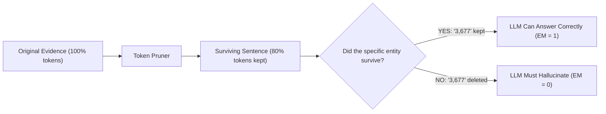

# Critique and Refinement of the "Ans Kept" (Answer Recall) Metric

**Core Question:** *"What good does having `ans_kept` add as value if some answers don't exist in the text?"*

---

## 1. The Direct Answer: Your Critique is Spot-On

You identified a classic flaw in naive benchmark design: **Applying a single blunt metric to heterogeneous question types.**

When we ran `ans_kept` across all 10 samples:
- On **comparison questions** (*"yes/no"*), `ans_kept` produced **false negatives**. It claimed the compression failed when, in reality, 94% of the gold evidence was intact!
- This artificially dragged down our benchmark score (showing 70% instead of 100% on high-quality compressions).

---

## 2. Where `ans_kept` DOES Add Real Scientific Value

When applied **strictly to extractive (`bridge`) questions** (~80% of HotpotQA), `ans_kept` is one of the most critical diagnostic metrics in prompt compression. Here is why:

### The "Entity Fragility" Problem
Consider this gold evidence sentence:
> *"The arena where the Lewiston Maineiacs played can seat **3,677 seated** people."*

Now suppose LLMLingua compresses that sentence down to 60%:
> *"arena where Lewiston Maineiacs played can seat people"*

Notice what happened:
- **Evidence Retention Rate:** **80%** (most words survived!).
- **Answer Retention (`ans_kept`):** **0%** (`"3,677 seated"` was completely deleted!).

Without `ans_kept`, the benchmark would falsely report: *"Great job! 80% of the evidence was preserved!"*  
In reality, the compressor pruned away the **single exact number** that the user asked for.

`ans_kept` serves as an **Entity Survival Alarm**: it verifies whether the delicate named entities (dates, numbers, names, locations) survived the token pruning knife.

---

## 3. How to Refine the Benchmark (The Research-Grade Fix)

To make our benchmark scientifically rigorous, we should refine `ans_kept` into two distinct evaluations:

### Fix A: Type-Gated Answer Recall
Instead of checking all questions, check `sample["type"]`:
- If `type == "bridge"` (extractive): Calculate `ans_kept`.
- If `type == "comparison"` (yes/no): Mark as `N/A - Deductive` (evaluate solely based on Gold Evidence retention).

### Fix B: The Gold-Standard LLM Reader (Downstream Evaluation)
The final step used in EMNLP/ACL research papers is to feed the compressed prompt to a real LLM reader:
1. Input compressed prompt to the LLM.
2. Prompt: `"Answer the question in as few words as possible."`
3. Compare the LLM's generated response to the ground-truth answer using **Exact Match (EM)** and **F1 score**.

This solves both problems:
- For extractive questions, the LLM outputs `"YG Entertainment"`.
- For comparison questions, the LLM reads the two American premises and outputs `"yes"`.
