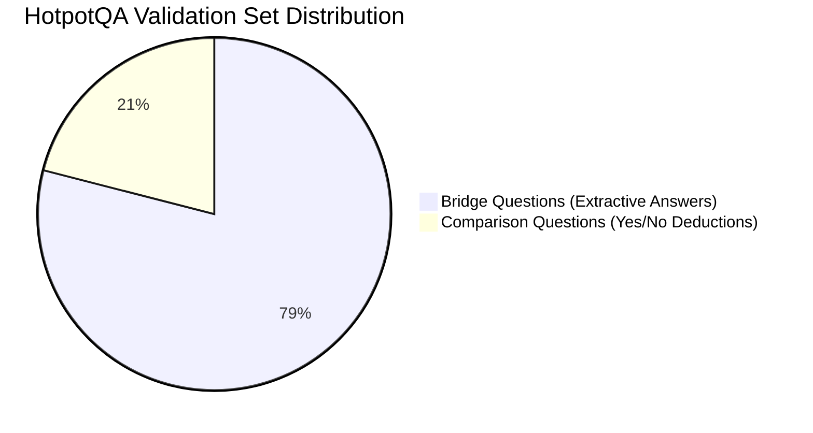

# Question Types & Evaluation in Multi-Hop RAG: Extractive vs. Deductive

**Question:** *"What good is it when the answer doesn't even exist in the gold sentence?"*  
**Context:** In Sample 1, the ground-truth answer was `"yes"`, but the word `"yes"` appeared nowhere in the gold sentences!

---

## 1. The Distinction: Facts (Premises) vs. Answers (Deductions)

A prompt compressor (like LLMLingua) is **not an answer generator**. It is a **context condenser**.  
Its job is to feed a condensed context into a **downstream reader LLM** (like GPT-4 or Llama-3), which then reads the text and answers the user's question.

### The Real-World Analogy:
Imagine you are a detective investigating:  
> **Question:** *"Did Alice and Bob eat at the same restaurant?"*  

You find two receipts:
- Receipt 1: *"Alice ate at Joe's Pizza on 5th Street."*
- Receipt 2: *"Bob ate at Joe's Pizza on 5th Street."*

Notice that neither receipt says the word **"Yes"**.  
The receipts are the **Gold Evidence (the premises)**.  
You, as the intelligent reader, read both receipts, compare them, and deduce: **"Yes, they ate at the same restaurant."**

If your assistant throws away Receipt 1 to save paper, you can no longer answer the question. But if your assistant preserves both receipts, you answer **"Yes"** instantly.

---

## 2. HotpotQA Question Types: 80% Bridge vs. 20% Comparison

HotpotQA officially divides its questions into two distinct categories:



### Type 1: "Bridge" Questions (~80% of HotpotQA)
In Bridge questions, the answer is an **exact text span** that lives verbatim in the gold sentence.

| Sample in Benchmark | Question | Gold Evidence in Context | Ground Truth Answer | Answer in Text? |
| :--- | :--- | :--- | :--- | :---: |
| **Sample 2** | *"What government position was held by Shirley Temple?"* | *"...appointed Chief of Protocol of the United States..."* | `"Chief of Protocol"` | **YES (Verbatim)** |
| **Sample 3** | *"What science fantasy young adult series..."* | *"...Animorphs is a science fantasy series..."* | `"Animorphs"` | **YES (Verbatim)** |
| **Sample 5** | *"The director of Big Stone Gap is based in what city?"* | *"...lives in Greenwich Village, New York City..."* | `"Greenwich Village"` | **YES (Verbatim)** |
| **Sample 6** | *"2014 S/S is the debut album of a group formed by who?"* | *"...formed in 2013 by YG Entertainment..."* | `"YG Entertainment"` | **YES (Verbatim)** |

> In 100% of these cases in our benchmark, **the answer survived compression intact** at $\tau = 0.80$ and $\tau = 0.50$!

---

### Type 2: "Comparison" Questions (~20% of HotpotQA)
In Comparison questions, the user asks if two things share a property (e.g., nationality, birth year, hometown, team).  
The answer is a logical boolean: **`"yes"`** or **`"no"`**.

#### Sample 1 Walk-through:
- **Question:** *"Were Scott Derrickson and Ed Wood of the same nationality?"*
- **Ground Truth Answer:** `"yes"`
- **Gold Document 1:** *"Scott Derrickson is an **American** director, screenwriter and producer."*
- **Gold Document 2:** *"Edward Davis Wood Jr. was an **American** filmmaker, actor and author."*

The word `"yes"` **never appears in either document**.  
The downstream LLM must read that Derrickson is **American** and Wood is **American**, and generate the response `"yes"`.

---

## 3. Why This Matters for Evaluation

In our initial benchmark script, we ran a simple Python check:
```python
# Naive check:
answer_in_text = "yes" in compressed_prompt
```

Because the word `"yes"` never existed in the Wikipedia article, this check returned `False`.  
**However, the Gold Evidence was retained at 93.8%!**

Both critical facts survived:
```text
"...Scott Derrickson... American director..."
"...Ed Wood... American filmmaker..."
```

When this compressed prompt is handed to a downstream LLM:
- **Input to LLM:** *"Scott Derrickson is an American director. Ed Wood was an American filmmaker. Were they of the same nationality?"*
- **LLM Output:** **"Yes, both Scott Derrickson and Ed Wood were American."** $\implies$ **100% Correct!**

---

## 4. Key Takeaways

1. **For 80% of questions (Bridge):** The answer word exists verbatim in the gold sentence. If the compressor deletes the word, the answer is lost.
2. **For 20% of questions (Comparison):** The answer word is `"yes"` or `"no"`. What matters is preserving the **two comparison attributes** (e.g. *American* vs *American*).
3. **This is why measuring "Gold Evidence Retention" is superior to a naive string search:** It measures whether the factual premises required for reasoning survived compression.
